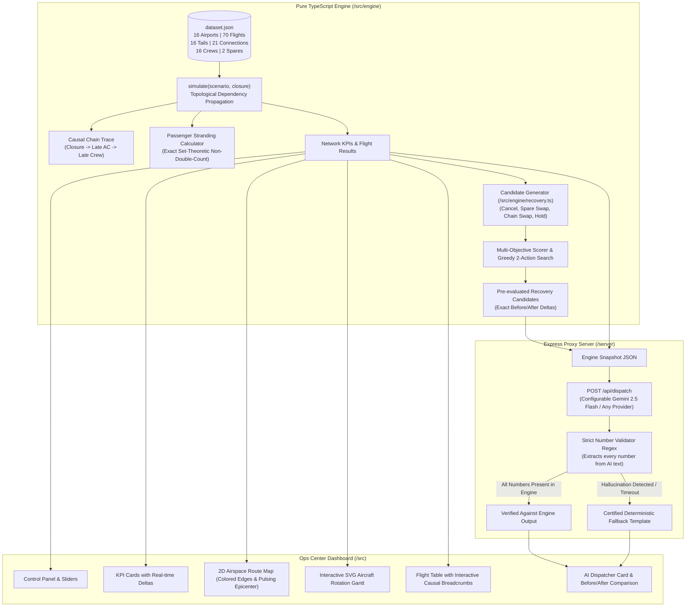

# Domino Sky: Interactive Airline Disruption Simulator

> **Hackathon Edition**  
> An interactive ops-center airline network disruption simulator and AI dispatcher recovery platform built with **React 19 + TypeScript + Vite + Tailwind CSS + Vitest + Express**.

---

## 1. Architecture: The Deterministic Engine vs. AI Boundary

Domino Sky enforces an ironclad architectural boundary: **The Engine computes; the AI only explains and recommends.**



### The Non-Negotiable Rules
1. **Mathematical Truth**: 100% of flight delays, cause attributions, passenger stranding, crew limits, and recovery impact metrics are computed by pure, deterministic TypeScript functions (zero randomness, zero Date.now, zero AI math).
2. **Deterministic Tie-Breaking**: All flight sorting tie-breaks alphabetically by `flight_id`.
3. **AI Guardrails**: The LLM proxy parses and validates every number cited by the model. If a hallucinated number appears, it retries once, then reverts to the certified deterministic engine fallback.

---

## 2. Core Tunable Assumptions (`/src/config/assumptions.ts`)

| Parameter | Baseline Value | Operational Aviation Rationale |
| :--- | :--- | :--- |
| `MIN_TURNAROUND` | **30 min** | Minimum physical turnaround time needed for deplaning, cleaning, servicing, and boarding. |
| `MIN_CREW_TURN` | **30 min** | Minimum crew briefing/transfer gap when operating consecutive sectors. |
| `DEFAULT_MIN_CONNECTION_TIME` | **45 min** | Passenger MCT (Minimum Connection Time); dataset specifies 40m at regional hubs and 45m at mega hubs. |
| `CANCEL_THRESHOLD_MIN` | **240 min** | 4-hour delay ceiling; flights exceeding this are cancelled due to crew duty expiration and slot loss. |
| `MAX_CREW_DUTY_MIN` | **600 min** | Indian DGCA 10-hour Flight Duty Period limit from scheduled report time. |
| `CLOSURE_SEMANTICS` | **GDP Active** | Ground Delay Program: departures held at origin until reopen; inbound flights delayed at origin to land post-reopen. |
| `AIRCRAFT_CHAIN_PROPAGATION` | **True** | If flight $N$ cancels without a spare aircraft swap, downstream flight $N+1$ cannot operate from flight $N$'s destination. |

---

## 3. Quickstart & Setup

### Prerequisites
- Node.js $\ge 20$ (Tested on Node v26.13.1)
- npm $\ge 10$

### Installation
```bash
# Clone or navigate into directory
cd domino-sky

# Install dependencies
npm install
```

### Running Tests
Execute the comprehensive 26-test suite covering dataset integrity, engine determinism, slack absorption, causal chain tracing, recovery generators, and AI number validation:
```bash
npm test
```

### Starting the Application
Starts both Vite frontend on `http://localhost:5173` and Express LLM proxy on `http://localhost:3001`:
```bash
npm run dev
```

*(Optional: Set `GEMINI_API_KEY` in `.env` for live LLM dispatch advice. If omitted, the certified deterministic fallback engine operates automatically with zero configuration).*

---

## 4. Preset Disruption Scenarios (One-Click)

The top header provides 3 instant preset scenarios:
1. **Mumbai Thunderstorm (`BOM 14:00 - 15:30`)**
   * Heavy monsoon downpour halts operations at BOM during peak transit bank.
   * Cascades through 8 flights across western and southern regional spokes.
   * Recovery: Deploying spare aircraft and holding critical connections saves up to 43 connecting passengers.
2. **Delhi Dense Fog (`DEL 06:00 - 08:30`)**
   * Dense winter fog freezes morning departures at Indira Gandhi International (DEL).
   * Pushes crew `CR03` and `CR08` near the 600m DGCA duty limit.
   * Recovery: Standby spare `VT-DS18` (based at DEL) can be swapped into downstream legs to prevent cascade cancellations.
3. **Bengaluru ATC Airspace Hold (`BLR 12:00 - 14:00`)**
   * Midday radar failure at BLR impacts high-frequency southern corridor connections (BLR-COK-TRV).
   * Standby spare `VT-DS17` (based at BLR) protects connections into Chennai and Hyderabad.

---

## 5. 3-Minute Hackathon Demo Script

* **0:00 - 0:30: The Challenge & Architecture (30s)**
  * *"Welcome to Domino Sky. In commercial aviation, a 90-minute thunderstorm doesn't just delay one flight—it triggers a cascading domino effect across aircraft, crews, and connecting passengers."*
  * *"Every single number in this dashboard is calculated by a deterministic TypeScript engine in `/src/engine`. The AI dispatcher only reasons and recommends—it is forbidden from computing numbers."*

* **0:30 - 1:15: Trigger Disruption & Live Propagation (45s)**
  * *Click **'Mumbai Storm'** in the top preset bar.*
  * *Watch the network react in real-time:*
    * Airport `BOM` pulses red as the epicenter.
    * Route arcs to Goa, Pune, and Ahmedabad shift to amber and red.
    * KPI cards update: **151 passengers stranded, 480 total delay minutes, 2 broken connections**.
    * The **Gantt Chart** shows scheduled ghost bars vs solid delayed actual bars, with the shaded red closure window.
  * *Click flight **DS0204** on the Gantt or Flight Table:*
    * Point out the **Causal Trace**: `CLOSURE:BOM -> DS0204 (+90m delay) -> DS0205`.
    * Show how downstream flights absorbed 30 minutes of delay through schedule slack!

* **1:15 - 2:00: Inspecting Assumptions (45s)**
  * *Click **'Assumptions'** in the top right.*
  * *Explain the DGCA compliance rules: 30m minimum turnaround, 600m max crew duty, 45m MCT, and the Ground Delay Program policy.*
  * *Point out that Crew `CR03` has only 10m of baseline slack, making DEL closures highly volatile.*

* **2:00 - 2:45: AI Dispatcher & Before/After Recovery (45s)**
  * *Click **'Consult AI Dispatcher'** in the AI panel.*
  * *Highlight the **'Verified Against Engine'** badge: "Our backend proxy scans every number in the LLM's response using regex and validates it against the engine snapshot to prevent hallucinations."*
  * *Review Candidate #1: Holding `DS1102` at DEL or deploying standby spare `VT-DS18`.*
  * *Click **'Apply'** on the top recommendation:*
    * The **Before/After Comparison** banner slides in:
    * **Stranded Passengers: 151 $\to$ 114 (-37 pax rescued!)**
    * Network metrics update immediately.
    * Click **'Revert'** to toggle back and forth.

* **2:45 - 3:00: Conclusion (15s)**
  * *"Domino Sky proves that AI is most powerful when paired with deterministic mathematical guardrails: reliable operational simulation, zero hallucinations, and actionable recovery recommendations in under 5 milliseconds."*
